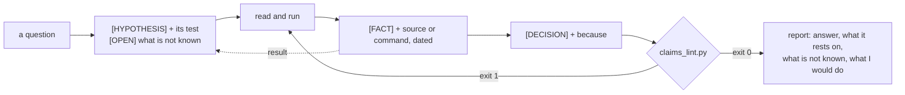

<div align="center">

# evidence-first-research

**A Claude skill: a research log in which every claim says what holds it up, and a linter that refuses the ones that don't.**

A model's research answer mixes what it read, what it ran, what it remembers and what it guesses, in one
confident voice. This skill keeps those apart, in a file a script can check.


</div>

---

## Four labels

| Label | It is | It must carry |
|---|---|---|
| `[FACT]` | read in a primary source, or seen in a run | `(source: URL, accessed DATE)` or `(measured: command, DATE)` |
| `[HYPOTHESIS]` | something that may be true | `(test: how it would be checked)`, later `(result: confirmed/refuted/inconclusive …)` |
| `[DECISION]` | something chosen | `(because: the reason)` |
| `[OPEN]` | something not known | a question mark |



## Before and after

The same question, "does `node --test` take a folder?", written twice.

<table>
<tr><th>Notes as they are usually written (part)</th><th>The log (part)</th></tr>
<tr>
<td width="50%">

```markdown
- `node --test tests/` runs every test
  in the folder.
- [FACT] The folder form works since
  Node 18.
- [FACT] It probably broke in Node 22
  (source: https://nodejs.org/api/test.html,
  accessed 2026-11-11)
- [DECISION] Use the folder form in CI
- [OPEN] Check the changelog
```

</td>
<td>

```markdown
- [FACT] `node --test tests/` exits 1 on
  Node v26.2.0, and its output starts with
  "Cannot find module" and the folder's path
  (measured: `node --test tests/`, 2026-11-11)
- [HYPOTHESIS] The folder form runs the nine
  tests under Node 20 (test: run
  `node --test tests/` under Node 20 in the
  same project folder)
- [DECISION] READMEs and CI name the test
  file, never the folder (because: the folder
  form exits 1 on Node 26, the file form
  exits 0, and both are measured above)
```

</td>
</tr>
</table>

The linter on the left one ([`examples/unlabelled-notes.md`](examples/unlabelled-notes.md)):

```text
$ python3 scripts/claims_lint.py examples/unlabelled-notes.md
examples/unlabelled-notes.md:6: no label: start with [FACT], [HYPOTHESIS], [DECISION] or [OPEN]
examples/unlabelled-notes.md:7: a fact needs (source: URL, accessed YYYY-MM-DD) or (measured: command or file, YYYY-MM-DD)
examples/unlabelled-notes.md:8: "probably" in a fact: a fact with a hedge in it is a hypothesis
examples/unlabelled-notes.md:9: a source needs the word "accessed" before its date
examples/unlabelled-notes.md:9: a source is a URL or a DOI (or run with --offline-sources)
examples/unlabelled-notes.md:10: (measured: …) must end with ", YYYY-MM-DD"
examples/unlabelled-notes.md:11: a hypothesis needs (test: how it would be checked)
examples/unlabelled-notes.md:12: a decision needs (because: the reason)
examples/unlabelled-notes.md:13: an open item is a question: it has a question mark
examples/unlabelled-notes.md:14: [fact] must be upper case: [FACT]
examples/unlabelled-notes.md: 9 claims (4 FACT, 1 HYPOTHESIS, 1 DECISION, 1 OPEN), 10 problems
```

And on the right one ([`examples/node-test-folder.md`](examples/node-test-folder.md)), then what it still does
not know:

```text
$ python3 scripts/claims_lint.py examples/node-test-folder.md
examples/node-test-folder.md: 12 claims (8 FACT, 2 HYPOTHESIS, 1 DECISION, 1 OPEN), 0 problems

$ python3 scripts/claims_lint.py examples/node-test-folder.md --open
examples/node-test-folder.md: 2 still open
  32: [HYPOTHESIS] The folder form runs the nine tests under Node 20
  37: [OPEN] In which Node version did the folder form stop working?
```

That log is real. It comes from a mistake in a draft README of
[`claude-skill-agent-progress-log`](https://github.com/DevCrazyCube/claude-skill-agent-progress-log), which told
people to run `node --test tests/`. Every command in the log was run, both documentation pages were read on the
day it names, and one of its hypotheses was tested while writing it and got its result.

## What the linter can and cannot do

| It checks | It cannot check |
|---|---|
| Every claim has one of the four labels | That the source says what the claim says |
| A fact has a source or a measurement, with a real date that is not in the future | That the command was really run |
| A source is a URL or a DOI and says when it was read | That the source is a primary one |
| A fact holds no hedge word ("probably", "should be", "seems" …) | That a decision follows from its reason |
| A hypothesis has a test, a decision a reason, an open item a question mark | That nothing was left out |

The right-hand column is what [`SKILL.md`](SKILL.md) is for: fourteen rules, among them *what you remember is
a hypothesis until you have looked*, *a third party's claim is a fact about the claim*, *never invent a
result*, *append, never rewrite*, and *unknowns fail loudly*.

## Install

```bash
git clone https://github.com/DevCrazyCube/claude-skill-evidence-first-research ~/.claude/skills/evidence-first-research
```

Python 3.8 or newer. Nothing to `pip install`.

## Use

Ask for it in words:

```text
Research whether our CI can drop Node 18. Keep an evidence-first log in docs/research/node18.md.
```

Or by hand:

```bash
cp ~/.claude/skills/evidence-first-research/research-log-template.md docs/research/my-question.md
# … write the log …
python3 ~/.claude/skills/evidence-first-research/scripts/claims_lint.py docs/research/my-question.md
```

A claim is a top-level list item; wrap long ones with indented lines. Prose, headings, fenced code and
checkbox items (`- [ ] …`) are left alone, so the log can hold notes and a to-do list as well.

<details>
<summary><b>Options</b></summary>

| Option | |
|---|---|
| `--open` | list the open questions and the hypotheses without a result; always exits 0 |
| `--max-age DAYS` | also fail a fact whose evidence is older than this |
| `--check-files` | a `(measured: some/file.json, DATE)` must name a file that exists, relative to the log |
| `--offline-sources` | accept a source that is not a URL or DOI (a book, a talk), still with its date |
| `--today YYYY-MM-DD` | use this date instead of the real one (for tests) |

Exit code 0 when clean, 1 when there are problems, 2 when the log cannot be read or an option is wrong.

To keep a plain list out of the check:

```markdown
<!-- claims: off -->
- any list
<!-- claims: on -->
```

</details>

<details>
<summary><b>Old evidence</b></summary>

Facts about things that change go stale. Six weeks after the example log was written:

```text
$ python3 scripts/claims_lint.py examples/node-test-folder.md --max-age 0 --today 2026-12-25
examples/node-test-folder.md:10: evidence is 44 days old (limit 0): check it again or make it a hypothesis
…
examples/node-test-folder.md: 12 claims (8 FACT, 2 HYPOTHESIS, 1 DECISION, 1 OPEN), 8 problems
```

(`--max-age 0` is used here only to show the message; pick a limit that fits how fast the subject moves.)

</details>

<details>
<summary><b>In CI</b></summary>

```yaml
- name: Research logs hold up
  run: python3 tools/claims_lint.py docs/research/*.md
```

The linter takes any number of logs and exits 1 if one of them has a problem. Copy `scripts/claims_lint.py`
into the repo (it is one file; `tools/` above is wherever you put it).

</details>

## Tests

```bash
python3 -m unittest discover -s tests
```

28 tests: how claims are found (wrapped lines, nested items, fences, checkboxes, the off switch), what each
label needs, dates, URLs with brackets and commas in them, the age limit, the file check, the command line's
output and exit codes, several logs in one run, and that the shipped template and passing example stay clean
while the failing example stays failing.

## Repo layout

```
SKILL.md                         what Claude reads: the four labels, fourteen rules, the report's shape
research-log-template.md         the empty log
scripts/claims_lint.py           the linter (standard library only)
tests/test_claims_lint.py        28 tests
examples/node-test-folder.md     a real log that passes
examples/unlabelled-notes.md     the same question as loose notes; it fails on every line
```

## Related

- [`claude-skill-cold-read`](https://github.com/DevCrazyCube/claude-skill-cold-read): a reader that has seen nothing checks whether the report can be understood.
- [`claude-skill-agent-progress-log`](https://github.com/DevCrazyCube/claude-skill-agent-progress-log): the same idea for progress: a log a script can check.

## License

MIT
